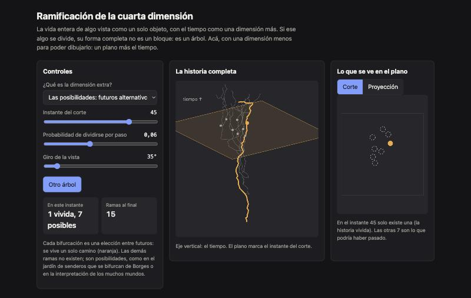

<div align="center">

# Branching Worldlines

**Ramificación de la cuarta dimensión.** La vida entera de algo que se divide, vista como un solo objeto: no es un bloque, es un árbol.

[**▶ Probala en vivo**](https://loiaconobruno.github.io/branching-worldlines/) · [Cómo funciona](#cómo-funciona) · [Limitaciones](#limitaciones)

[](https://github.com/LoiaconoBruno/branching-worldlines/actions/workflows/tests.yml)


[](LICENSE)



</div>

Visualización interactiva de una idea: si mirás la vida entera de algo como un solo objeto, con el tiempo como una dimensión más, y ese algo se divide, su forma completa no es un bloque: **es un árbol**. Lo que vemos día a día son sus cortes.

Para poder dibujarlo, la página usa una dimensión menos: un objeto en un **plano** que se divide con el tiempo. Su historia completa (plano + tiempo) es un árbol en 3D. La idea original (espacio 3D + tiempo = árbol 4D) funciona igual con una dimensión más.

## Por qué

La idea mezcla tres "cuartas dimensiones" distintas: espacio extra, tiempo y posibilidades. La página obliga a elegir y muestra la diferencia:

- **El tiempo:** todas las ramas existen de verdad, como el linaje de una célula que se divide. En un instante se ven varios objetos separados que en la historia completa son una sola pieza.
- **Las posibilidades:** cada bifurcación es una elección entre futuros. Se vive un solo camino; las demás ramas son lo que podría haber pasado.

También muestra dos ajustes de la idea: un objeto que no se ramifica se ve como un **tubo**, no como un árbol, y un **corte** no es lo mismo que una **proyección** (una sombra).

## Instalación

No hace falta instalar nada: **[abrila en el navegador](https://loiaconobruno.github.io/branching-worldlines/)**.

Para usarla sin conexión o modificarla:

```bash
git clone https://github.com/LoiaconoBruno/branching-worldlines.git
```

Después abrí `index.html` con doble clic. No hay dependencias ni paso de build. Para correr los tests hace falta Node 18 o más nuevo:

```bash
npm test
```

## Uso

Abrí la [demo en vivo](https://loiaconobruno.github.io/branching-worldlines/) o `index.html` con doble clic.

Ejemplo:

1. Al abrir, la dimensión extra es **el tiempo** y el corte está en el instante 45. En este instante hay **8 piezas** y al final hay **15 ramas**. A la izquierda se ve el árbol completo con el plano del corte; a la derecha, los 8 objetos separados que ve alguien adentro del plano.
2. Cambiá a **Las posibilidades: futuros alternativos**: el árbol es el mismo, pero se resalta en naranja la única historia vivida. En este instante hay **1 vivida y 7 posibles**.
3. Apretá **Proyección**: el plano muestra la sombra de toda la historia junta, donde ya no se distingue el antes del después.
4. Volvé a **Corte**, elegí **El tiempo** y poné la **probabilidad de dividirse** en 0: queda **1 pieza** y la historia completa es un tubo.
5. **Giro de la vista** rota el árbol y **Otro árbol** genera uno nuevo.

## Cómo funciona

- Una célula arranca en el centro del plano. En cada paso se mueve un poco al azar y, con cierta probabilidad, se divide en dos hijas que se separan.
- Cada célula guarda su trayectoria `[t, x, y]`. El árbol se dibuja en perspectiva con el tiempo hacia arriba.
- **Corte:** las células que existen en el instante elegido.
- **Proyección:** todos los puntos de todas las trayectorias, aplanados sobre el plano.
- **Historia vivida:** desde la raíz, en cada división se elige una hija al azar hasta llegar a una hoja.
- Todo usa un generador pseudoaleatorio con semilla, así que el mismo árbol se puede reproducir.

La lógica está en `src/arbol.js`, sin DOM, y se testea con:

```bash
npm test
```

## Limitaciones

- Es una dimensión menos que la idea original: plano + tiempo en lugar de espacio + tiempo.
- No modela la cuarta dimensión espacial (un teseracto cruzando nuestro espacio), que es la tercera lectura posible de la idea.
- La interpretación de los muchos mundos es una interpretación, no un hecho probado: el modo "posibilidades" es una imagen, no física.

## Próximos pasos

- Versión con espacio 3D + tiempo: mostrar los cortes 3D de un árbol 4D con three.js.
- Agregar la tercera lectura: un objeto 4D espacial que atraviesa nuestro espacio.
- Escribir el concepto en una página, eligiendo cuál de las tres dimensiones es la de la idea.

## Licencia

MIT
